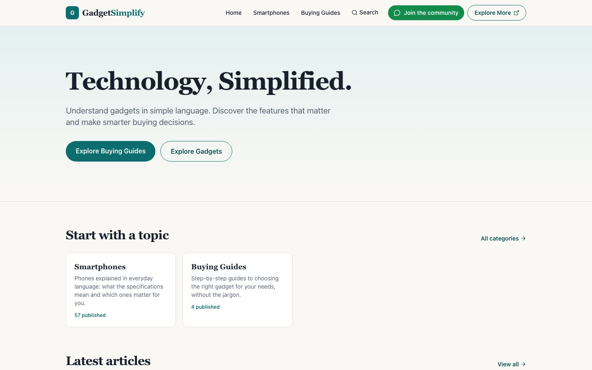

"Which phone should I buy?"

If you work in tech, you hear this question all the time. And the funny part is that tech people ask it too. When a new phone, laptop or pair of earbuds is due, even we end up with twenty browser tabs open, a spec sheet we only half understand, and reviews that all end with "it depends."

I wanted to fix that one small problem. So I built [GadgetSimplify](https://gadgetsimplify.in), and I built it in **under two hours** using Claude Code.

## The problem: too much information, no decision

Spec sheets tell you what a gadget *has*. Reviews tell you what a reviewer *felt*. Neither one tells you the thing you actually want to know: **should I buy this?**

Choosing a gadget isn't hard because information is missing. It's hard because there's too much of it, written in language that assumes you already know what a "good" number is.

## The idea: explain it simply, then give a verdict

GadgetSimplify has one job: explain gadgets in simple language, so you can understand the features that matter and make a smarter buying decision.

The part I care about most is a **verdict section on every review page**. After the explanation, the page tells you plainly **when you should buy this gadget**. You read it, compare it with your own situation, and decide. That's it. No scoring spreadsheet, no fence-sitting.

## Building it with Claude Code

I had the idea, and I wanted to see how far I could get without turning it into a long project. With Claude Code, I went from an idea to a live website in under two hours.

Here is the shape of what I ended up with:

- **Next.js** for the site itself.
- **No database.** All the content, the articles and categories, lives in plain **JSON files**. A site like this doesn't need a database: there's nothing to log in to, nothing to migrate and nothing to keep running.
- **Cloudflare** for deployment, so the site is fast and there is very little to maintain.

That last point matters more than it sounds. Because the content is just files, adding a new gadget means adding a new entry, and the site rebuilds. The simplicity of the setup is a big part of why two hours was enough.

## A note on affiliate links

I use affiliate links on some products. That means if you buy something through one of those links, I may earn a commission. The verdict on a page is written to help you decide, whether or not a link is there.

## What I took away from it

- **Start from a real problem.** I didn't start with "let me build a website." I started with a question that I and everyone around me keep asking.
- **Keep the scope small.** One idea, explained simply, with one feature that does the heavy lifting: the verdict.
- **Pick boring, simple tools.** Files instead of a database and static hosting instead of servers meant less to build and less to break.
- **AI makes the first version cheap.** The hard part is no longer getting something live. It's deciding what is worth building.

If you're about to buy a phone or another gadget, take a look at [GadgetSimplify](https://gadgetsimplify.in). And if there's a gadget you'd like explained, message me on WhatsApp. I'd love to hear which one.

## FAQ

### How long did it take to build GadgetSimplify?
Under two hours, from the first idea to a live website, using Claude Code.

### Which gadget buying question does GadgetSimplify answer?
The one every tech person faces: which phone, or which other gadget, should I buy? Each review page ends with a verdict that says when you should buy the gadget.

### Does GadgetSimplify use a database?
No. The content lives in JSON files, and the site is built with Next.js and deployed on Cloudflare.

### Does GadgetSimplify use affiliate links?
Yes, on some products. I may earn a commission if you buy through those links.

