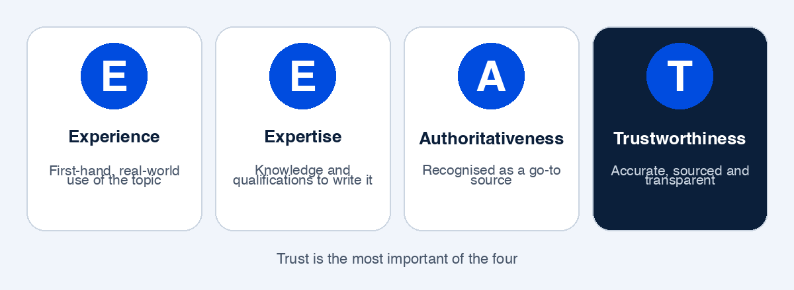

I built [Pharmacist Notes](https://pharmacistnotes.com), did what I thought was enough research about Google AdSense, applied, and got **rejected**.

It was a shock. Instead of just applying again, I decided to dig deep and find out what was really wrong. This post is what I learned, what the problems were, and what I'm doing about them. I'm still in the middle of fixing things, so think of this as a work in progress, not a success story.

## What happened

The sequence was simple:

1. I created Pharmacist Notes, a medicine and health information website.
2. I did some **trivial research** on AdSense. I read the basics, but I didn't dig into what a reviewer actually looks at.
3. I applied.
4. I was rejected, and the reason given was **thin content**.

Looking back, step 2 was the mistake. I treated AdSense approval like a form to fill in, when it's really a quality review of the whole website.

## What "thin content" really means

"Thin content" doesn't only mean a page with few words. It means content that adds **little or no value** for a visitor. A long page can still be thin if it only repeats what is already on a hundred other websites.

When I looked at my site honestly, I could see why it qualified. I'll go through each problem I found.

## What I found when I dug deeper

### 1. My E-E-A-T was weak

This was the biggest eye-opener, and it's the part most beginners have never heard of. **E-E-A-T** is a framework from Google's quality guidelines. It stands for:

- **Experience**: does the author have first-hand experience with the topic?
- **Expertise**: does the author have the knowledge or qualifications to write about it?
- **Authoritativeness**: is the site or author recognised as a go-to source?
- **Trustworthiness**: can a visitor trust the information, the site and who is behind it? Google describes trust as the most important of the four.

E-E-A-T is not a single score or a switch. It's a way of judging whether content is reliable, and it matters most for topics where bad information can hurt people. Google calls these "Your Money or Your Life" topics, and **health and medicine are exactly that**.

<picture>
<source media="(max-width: 639px)" srcset="/blog/images/eeat-mobile.png">

</picture> A medicine website is held to a much higher standard than, say, a recipe blog.

I have a D.Pharm diploma, but a visitor can't see that unless the site shows it clearly. On my site, the signals of experience, expertise and trust weren't strong enough.

### 2. The content was thin

There wasn't enough genuinely useful content. A topic as big as medicines needs depth, and thin pages don't give a reviewer much to judge or a reader much reason to come back.

### 3. Not many pages were indexed

Not many of my pages were **indexed** by Google. A page that isn't indexed can't appear in search results at all. And a site with few indexed pages doesn't look like an established website.

You can see this yourself in Google Search Console, under the pages report. It tells you which pages are indexed and, usefully, why others aren't.

### 4. The AI content wasn't properly verified

I had used AI to help with some of the writing, and I hadn't verified it well enough. I'm not saying AI content is banned. As I understand it, Google's focus is on whether content is helpful and accurate, not on how it was produced. But for medical content in particular, unchecked AI text is risky: it can sound confident and still be wrong. Publishing it without careful review was a real mistake, and for a pharmacy website it's an even bigger one.

### 5. The content was "bookish" and nothing was unique

My articles read like a textbook. They were correct in places, but they gave information that could be found anywhere. There was **nothing new or unique** about my own approach: no real examples, no practical explanation, no perspective that came from my own background.

Search engines and AdSense reviewers both ask the same question: *why should this page exist when similar pages already do?* I didn't have a good answer.

### 6. There were no proper sources or links

For medical information, saying where facts come from is essential. My pages didn't properly cite sources, and they didn't link out to the authoritative references that back up what was written. Without sources, a reader (or a reviewer) has no way to check anything, which hurts trust directly.

### 7. The UI was weak and the links weren't accessible

The design wasn't good. Links weren't accessible: they were hard to find and hard to use, which makes a site difficult to move around and difficult to review. A clear, simple, usable layout is part of looking trustworthy.

## What I decided: refine first, then wait

I decided not to rush into a second application. If I reapply with the same site, I'd expect the same answer. So I chose to **refine the site properly and wait** before trying again.

That's where I am now: working on it.

## What I'm working on

This is how I'm approaching each of the problems above. It's still in progress, and I'll update this post as I go.

1. **Show who is behind the site.** Make my background and the purpose of the site clear, with proper About, Contact and editorial pages.
2. **Write fewer, better articles.** Quality over quantity: each page should answer a real question completely.
3. **Verify every claim.** Check every medical statement against reliable references, and never publish AI-assisted text I haven't reviewed.
4. **Cite sources and link to them.** Back up facts with authoritative references so readers can verify them.
5. **Add my own angle.** Explain things in plain language, with practical examples, instead of copying a textbook's tone.
6. **Get pages indexed.** Use Google Search Console to see what's indexed and fix whatever is blocking the rest.
7. **Improve the design and navigation.** Make links and menus clear, accessible and easy to use on any device.

## What I learned

- **AdSense is a quality review of your whole site**, not a form. Treat it that way from the first day.
- **Health content needs a higher standard.** Accuracy, sources and visible expertise aren't optional.
- **AI can help you write, but it can't replace verification.** You are responsible for every sentence you publish.
- **Original beats complete.** A page that only repeats what everyone else says gives a reviewer nothing to approve.
- **A rejection is information.** Mine pointed at real problems that I would have kept ignoring.

## A checklist before you apply for AdSense

Based on my mistakes, these are the things I'd check before applying:

- Is each page useful and original, not just long?
- Do you show who writes the site and why they're qualified?
- Are facts sourced, with links to reliable references?
- Has every piece of AI-assisted text been checked by a human who knows the subject?
- Are your important pages indexed in Google Search Console?
- Are About, Contact, Privacy Policy and Disclaimer pages easy to find?
- Is the site easy to use, with clear and accessible navigation?

## Where this goes next

I'll keep refining Pharmacist Notes, and I'll update this post with what happens next, good or bad. If you're working on a health, finance or any other sensitive-topic site, I hope my mistakes save you some time. And if you've been through an AdSense rejection yourself, I'd like to hear what you learned. Message me on WhatsApp.

Google's own guide to writing helpful, reliable, people-first content is worth reading: [Creating helpful, reliable, people-first content](https://developers.google.com/search/docs/fundamentals/creating-helpful-content).

## FAQ

### Why was my site rejected by Google AdSense for thin content?
Thin content means pages that add little value for visitors. In my case the pages were too few, too generic and too similar to what already exists online, and they were missing sources and originality.

### What does E-E-A-T stand for?
Experience, Expertise, Authoritativeness and Trustworthiness. It's the framework Google's quality guidelines use to judge how reliable content is, and it matters most for health and medicine topics.

### Is AI-written content banned by Google?
As I understand it, Google cares about whether content is helpful and accurate, not about how it was written. But for medical content, unverified AI text is risky, so every statement has to be checked by someone who knows the subject.

### How do I check whether my pages are indexed?
Use Google Search Console. The pages report shows which pages are indexed and gives reasons for the ones that aren't.

### Should I reapply straight after a rejection?
I decided not to. If you reapply without fixing the underlying problems, you'll likely get the same answer. I'm improving the site first.
