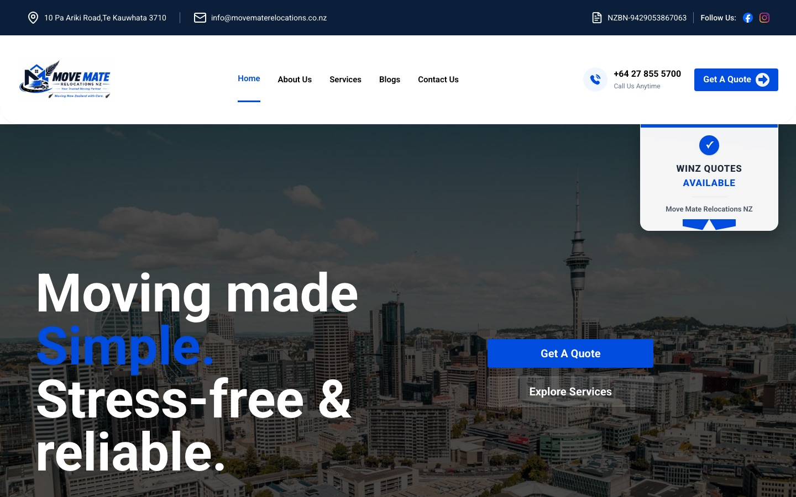

A client once asked me for a simple thing: rank on Google for a handful of keywords. One of them was **"hamilton furniture movers"**. After a blog page and a steady run of social media posts, [Move Mate Relocations](https://movematerelocations.co.nz) now appears on the first page of Google for that keyword.

It didn't look that simple at the start. This is the story of why the keyword was so hard, what we changed, and the pointers I would pass on to anyone with a similar problem.

## The brief: keywords from the client

Move Mate Relocations is a New Zealand moving company offering house, office, warehouse and intercity relocation. When I worked on their website, the client had a clear wish: they wanted to show up for a specific set of search terms, because those are the words their customers type when they need a mover.

That's a reasonable request. It's also where the real work begins, because a keyword is not something you can simply "add" to a website.

## Why these keywords were so hard

There were two problems.

**The keywords were very generic.** Phrases like "furniture movers" plus a city name are what almost every moving company in that city wants to rank for. Many businesses already target them, and Google has plenty of established pages to choose from.

**One keyword was another website.** "Hamilton furniture movers" wasn't just a phrase people search for. It was also the name of an existing website. When a search term matches a site's own name, that site starts with a big advantage, because the site's name and its pages line up with exactly what the searcher typed. Beating a result like that with a normal page is difficult.

So we had a client who needed a result, a keyword where everyone was competing, and one result that seemed to own the exact phrase.

## What we did

We didn't look for a trick. We decided to build up the website's relevance and visibility for that phrase in two ways.

### 1. We started posting on social media

We added social media posts for the business. Move Mate has a presence on Facebook and Instagram, and the posts kept the business and its services in front of real people in the area.

I want to be honest here: social media posts are not a direct ranking factor on their own. What they do is make the brand more visible, give people a reason to visit and search for the business, and give the website more places to be mentioned. We used them as support for the main change below, not as a replacement for it.

### 2. We added a new blogging page with location guides

The bigger change was a dedicated blog on the website. Instead of hoping the home page would rank for every city, we created a **blog hub with a page for each location**: Hamilton, Tauranga, Huntly and Auckland furniture movers.

Each location page is built around one clear idea. The Hamilton page is called "Hamilton Furniture Movers: Reliable Local and Intercity Relocation", and its description explains how Move Mate helps Hamilton families and businesses with careful furniture moving, packing and stress-free delivery. The title, the heading and the description all say what the page is about, in plain words, so both people and search engines understand it straight away.

That structure matters. A page that exists only for "hamilton furniture movers" has a much stronger case to rank for it than a general services page that mentions Hamilton once.

## The result

**Move Mate Relocations reached the first page of Google results for "hamilton furniture movers".**

I can't tell you which single change did it, and I'd be suspicious of anyone who claims they can. SEO depends on many signals at once. What I can say is that the result came after we added the blog with dedicated location pages and began posting on social media, and that the combination moved a keyword that looked out of reach.

## Pointers if you're facing the same problem

These are general lessons from this project, not a full list of everything we did.

1. **Search the keyword yourself first.** Look at who ranks and why. Is it a directory, a big brand, or, as in our case, a site whose name is the keyword? You can't plan a way in until you know what you're up against.
2. **Give every important keyword its own page.** One page, one clear topic. Make the title, the main heading and the description say the same thing.
3. **Write for the customer's question, not just for the keyword.** Explain the service, the area you cover and what makes the move easier. Pages that help people tend to keep them reading.
4. **Add location pages, not just one "services" page.** If you serve several cities, a page per city lets each one compete on its own.
5. **Support your pages with social posts.** Use them to point people to your content and to keep the brand visible, but don't expect social posts alone to change your rankings.
6. **Get the basics right.** Make sure pages can be crawled, load quickly on mobile and are listed in your sitemap. Move Mate's site is built with Next.js, which makes this straightforward.
7. **Measure and be patient.** Use Google Search Console to watch which searches bring people in, and give changes time to take effect.
8. **Earn the result with useful content.** Don't try to imitate a competitor's name. A better, clearer page is the safer way to win.

## What I took away

The biggest lesson: **a "very hard" keyword is usually a question of focus.** Once the site had a page that was clearly about Hamilton furniture movers, backed by a business that was visible online, the keyword stopped looking impossible.

It also reminded me that SEO is a team job. The client knows the customers, a developer builds the structure, and the content and the social posts have to work together.

If you run a local business and want to show up for the searches your customers use, you can see how we organised it on the [Move Mate blog](https://movematerelocations.co.nz/blog/) and the [Hamilton furniture movers page](https://movematerelocations.co.nz/blog/hamilton-furniture-movers/). And if you'd like help with something similar, message me on WhatsApp.

## FAQ

### Can you rank for a keyword that is another website's name?
It's harder, but it's possible. For "hamilton furniture movers", we reached the first page by building a dedicated page for the keyword and supporting it with social media posts.

### What was the main change that helped?
A new blog with its own page for each location, including a Hamilton furniture movers page. Social media posts supported it.

### Do social media posts improve Google rankings?
Not directly. They increase visibility and send people to your site, which supports your other SEO work.

### Which locations does the Move Mate blog cover?
Hamilton, Tauranga, Huntly and Auckland furniture movers.
