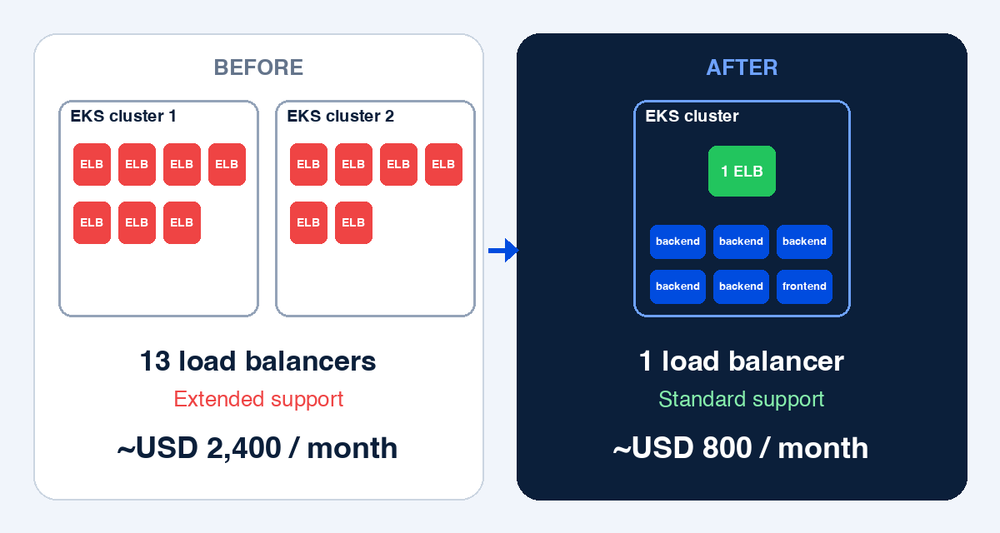

A customer asked my company to review what they were paying to run their deployments. The bill was about **USD 2,400 a month**. After we reorganised the setup, it came down to about **USD 800 a month**, roughly **two-thirds less**, with the same applications running.

Nothing exotic was involved. Most of the savings came from two big things, too many load balancers and a costly EKS support tier, plus a leaner setup that scales with demand. For confidentiality I can't name the customer, but the lessons apply to almost any team running Kubernetes on AWS (Amazon EKS).

## The situation

The customer's applications were running fine, but the infrastructure bill kept bothering them. They wanted someone to look at the deployments and tell them where the money was going.

I started where I always start: by listing what was actually running, instead of guessing.

## What we found

Here is what I found in the customer's AWS account:

- **Two separate Amazon EKS clusters.** One cluster had **7 load balancers (ELBs)** and the other had **6**. That's 13 load balancers in total.
- **One database.**
- **Several EC2 machines** provisioned for the workloads.
- **Both clusters were on Kubernetes extended support.** On EKS, that's an extra charge on top of the normal cluster price.

Seeing the list is half the work. Once everything is written down, the expensive parts are hard to miss.

## Why it cost so much

### 13 load balancers

Every load balancer is billed on its own. If each service gets its own ELB, the bill grows with every service you add, even when the traffic is small. Thirteen of them was a clear sign that the setup had grown service by service, with nobody stepping back to merge them.

### Extended support was the major culprit

The bigger problem was support. Both EKS clusters were running Kubernetes versions that had moved into **extended support**, which is charged on top of the normal cluster price. When you have more than one cluster on an old version, that extra cost adds up fast. This turned out to be a **major part of the bill**.

## What we changed

We didn't tweak the old clusters. We built a new, clean setup next to them and moved over.

### 1. A new cluster on the latest Kubernetes version

We created our own new Kubernetes cluster on the **latest version**, which doesn't need extended support, and set it to **standard support**. That removed the extended-support charge at the source. Staying on a current version is the simplest way to avoid it.

### 2. One load balancer for everything

Instead of one load balancer per service, we deployed the workloads behind **a single ELB** that serves **5 backend services and 1 frontend service**. Thirteen load balancers became one.

### 3. Autoscaling with HPA

We sized the capacity to match the actual load. The new cluster runs on a minimum of **2 machines** and a maximum of **5**. On top of that, **every service has its own HPA (Horizontal Pod Autoscaler) YAML file**, six in total: five backend services and one frontend. Each one lets its service scale between **1 and 5 replicas**, and they all share the same settings, which keeps the setup easy to read and maintain.

The settings are simple:

- **Scale on CPU.** A service adds replicas when its average CPU usage goes above **70%**.
- **Scale up quickly.** After a 60-second stabilisation window, it can add replicas fast: up to 100% more, or at least one extra pod, every minute. When two policies apply, the one that allows the bigger change wins (`selectPolicy: Max`).
- **Scale down slowly.** It waits **5 minutes** before removing anything, and then removes at most half of the replicas per minute. This avoids replicas flapping up and down when traffic is uneven.

Quiet periods cost less, and busy periods are still covered.

Here is what one of these HPA files looks like. The names are placeholders, because the real ones would identify the customer, but the settings are the real ones:

```yaml
apiVersion: autoscaling/v2
kind: HorizontalPodAutoscaler
metadata:
  name: backend-service-hpa
  namespace: app
spec:
  scaleTargetRef:
    apiVersion: apps/v1
    kind: Deployment
    name: backend-service

  minReplicas: 1
  maxReplicas: 5

  metrics:
    - type: Resource
      resource:
        name: cpu
        target:
          type: Utilization
          averageUtilization: 70

  behavior:
    scaleUp:
      stabilizationWindowSeconds: 60
      policies:
        - type: Percent
          value: 100
          periodSeconds: 60
        - type: Pods
          value: 1
          periodSeconds: 60
      selectPolicy: Max

    scaleDown:
      stabilizationWindowSeconds: 300
      policies:
        - type: Percent
          value: 50
          periodSeconds: 60
      selectPolicy: Max
```

### 4. Free SSL certificates from AWS

We used **AWS's free SSL certificates** for HTTPS, so there was no separate certificate cost.

### 5. Delete the old clusters only after the new one works

We didn't switch things off until the new setup was proven. Once everything was **running correctly on the new cluster**, we **deleted the two old clusters**. Cutting over only after the new setup works is what keeps a cost project from becoming an outage.

## The result



| | Before | After |
| --- | --- | --- |
| EKS clusters | 2 | 1 |
| Load balancers | 13 (7 + 6) | 1 |
| Kubernetes support | Extended support | Standard support |
| Capacity | Several EC2 machines | 2 to 5 machines, services autoscaled with HPA (1 to 5 replicas each) |
| Monthly cost | about USD 2,400 | about USD 800 |

The customer's monthly bill dropped by about **two-thirds**, from roughly USD 2,400 to roughly USD 800 a month.

## A checklist for your own AWS bill

These are general lessons from this project, not an exact recipe for your setup:

1. **List everything first.** Count your clusters, load balancers, databases and instances before changing anything.
2. **Count your load balancers.** If every service has its own, ask whether one can serve several.
3. **Check your Kubernetes version and support tier.** Extended support can quietly become one of your biggest charges.
4. **Match capacity to load.** Set a sensible minimum and maximum and let autoscaling do the rest.
5. **Use free options where they exist.** AWS provides free SSL certificates for its services.
6. **Build the new setup before deleting the old.** Delete only after the new one has been proven.
7. **Review regularly.** Costs creep up as systems grow. A short review every few months is cheaper than a surprise bill.

## What I took away

Cloud bills rarely get big because of one dramatic mistake. They grow through many small, reasonable decisions: another service, another load balancer, a version nobody had time to upgrade. The way back is the same in reverse: look at what is running, question each piece, and simplify.

If your AWS or Kubernetes bill feels higher than it should, I'm happy to talk about it. Message me on WhatsApp.

## FAQ

### How much did the customer save?
Their bill went from about USD 2,400 a month to about USD 800 a month, a reduction of roughly two-thirds, or about USD 1,600 saved every month.

### What was the biggest cause of the high cost?
Kubernetes extended support on two EKS clusters, together with 13 separate load balancers.

### How can you avoid EKS extended support charges?
Run a Kubernetes version that is still under standard support and plan upgrades before it ages out. We created a new EKS cluster on the latest version and set it to standard support.

### How many load balancers does a Kubernetes setup need?
It depends on your design, but it often needs far fewer than one per service. Here, a single ELB served 5 backend services and 1 frontend service.
